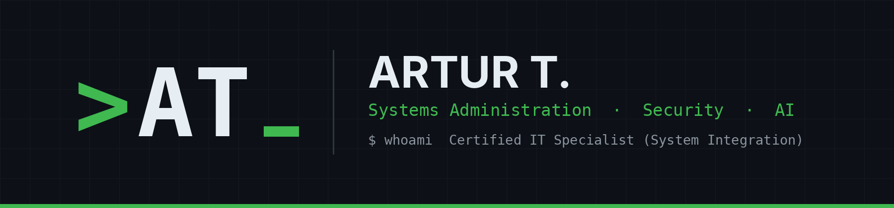

<picture>
  <source media="(prefers-color-scheme: dark)" srcset="assets/banner-dark.png">
  <source media="(prefers-color-scheme: light)" srcset="assets/banner-light.png">
  
</picture>

  
  
  

## About

Certified IT specialist for system integration with a broad focus on administration, automation, security and AI. I rebuild real-world IT environments to learn new stacks hands-on, automate the work around them and look at how they can be attacked and defended. Everything I build, break and learn ends up documented here.

## Currently

- Rebuilding real-world IT stacks to learn them hands-on, across administration, automation, security and AI
- Working through Hack The Box machines and writing them up with remediation
- Learning Azure, AD and cloud security

## Featured Projects

| Project | What it shows |
|---|---|
| [onboarding-automation](https://github.com/tscherwinski/onboarding-automation) | AD, mail server, ticket system and intranet in VMs, plus automated onboarding with role-based permissions |
| [doc-assistant](https://github.com/tscherwinski/doc-assistant) | Local AI stack in Docker with OCR, LLM field extraction and RAG search with sources |
| [writeups](https://github.com/tscherwinski/writeups) | Retired HTB machines, TryHackMe rooms and CTFs, each with attack path and remediation |

[View all homelab projects →](https://github.com/search?q=user%3Atscherwinski+topic%3Ahomelab&type=repositories)

## Latest Writeups

<!-- WRITEUPS:START -->
<!-- WRITEUPS:END -->

## Core Stack

`Windows Server` `Active Directory` `Arch Linux` `Networking` `PowerShell` `Bash` `Kali Linux` `Burp Suite`
